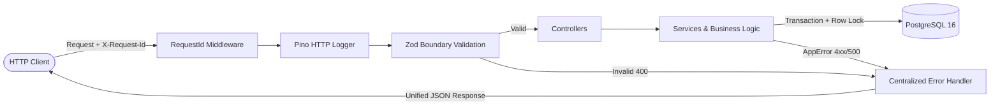

# 🛒 Cart RESTful API - Production Ready

> **Chuyên đề:** RESTful API có Contract: OpenAPI, Validation, Error Contract & Structured Logging  
> **Tech Stack:** Node.js (v20+), TypeScript, Express.js, PostgreSQL 16 (Docker), Zod, OpenAPI 3.1 (Scalar), Pino

---

## 📌 1. Giới thiệu tổng quan kiến trúc (Architecture Overview)

Dự án áp dụng phương pháp tiếp cận **Code-First với Single Source of Truth**:
- **Một nguồn định nghĩa duy nhất:** Toàn bộ schemas được khai báo bằng **Zod** kết hợp `@asteasolutions/zod-to-openapi`. Schema này vừa chịu trách nhiệm kiểm tra tính hợp lệ của request ngay tại gateway (**Boundary Validation**), vừa tự động sinh ra tài liệu **OpenAPI 3.1.0** mà không cần viết file YAML thủ công, loại bỏ hoàn toàn nguy cơ lệch đặc tả (schema drift).
- **Phân tầng rõ ràng (Layered Architecture):**
  - `src/middlewares/`: Tracing `X-Request-Id`, Structured Logging (Pino), Boundary Validation (Zod), Centralized Error Handler.
  - `src/controllers/`: Tiếp nhận HTTP request, điều phối Service và trả HTTP Response status.
  - `src/services/`: Chứa 100% nghiệp vụ (Business Rules), giao dịch DB (Transactions) và tính toán tiền (`subtotal_cents`) an toàn phía server.
  - `src/db/`: Quản lý kết nối PostgreSQL (Pool & Kysely), Migration SQL DDL và Seeding data sạch.



---

## 🚀 2. Hướng dẫn cài đặt & Khởi chạy (Quick Start)

### Yêu cầu tiên quyết:
- **Node.js** v20+ và **npm**
- **Docker** và **Docker Compose** (đã bật Docker Desktop)

### Bước 1: Khởi động cơ sở dữ liệu PostgreSQL 16
Khởi chạy container PostgreSQL 16 kèm healthcheck:
```bash
docker compose up -d
```
*Kiểm tra trạng thái container:*
```bash
docker compose ps
```

### Bước 2: Khởi tạo bảng & Nạp dữ liệu mẫu (Reset DB)
Chạy script tự động drop bảng cũ, chạy migrations và seed 5 sản phẩm + 1 cart đã đóng:
```bash
npm run db:reset
```

### Bước 3: Khởi chạy Server ở môi trường Development
```bash
npm run dev
```
Server sẽ chạy tại: **`http://localhost:3000`**

---

## 📖 3. Tài liệu tương tác API Documentation (`/docs`)

Dự án tích hợp giao diện tài liệu tương tác **Scalar API Reference** hiện đại tại:
- 🌐 **Interactive Docs UI:** [http://localhost:3000/docs](http://localhost:3000/docs)
- 📄 **Raw OpenAPI 3.1 JSON Spec:** [http://localhost:3000/openapi.json](http://localhost:3000/openapi.json)

---

## 📋 4. Bảng tổng hợp 6 Endpoints chuẩn RESTful

| STT | Method | Path | Request Body / Query / Params | Response Status | Mô tả nghiệp vụ |
| :---: | :---: | :--- | :--- | :---: | :--- |
| **1** | `GET` | `/products` | Query: `limit=20` (max 50), `offset=0` | `200`, `400`, `500` | Lấy danh sách sản phẩm đang bán (`is_active = true`). |
| **2** | `POST`| `/carts` | Không có body | `201`, `500` | Tạo giỏ hàng mới rỗng (`status = 'open'`). Trả về header `Location: /carts/{id}`. |
| **3** | `GET` | `/carts/{cartId}` | Param: `cartId` (UUID) | `200`, `400`, `404`, `500` | Xem chi tiết giỏ hàng, danh sách items và `subtotal_cents` tính từ giá trong DB. |
| **4** | `POST`| `/carts/{cartId}/items` | Body: `{ "product_id": UUID, "quantity": 1..10 }` | `201`, `400`, `404`, `409`, `422`, `500` | Thêm sản phẩm vào giỏ. Kiểm tra cart mở, tồn kho, sản phẩm active và chống trùng item. |
| **5** | `PATCH`| `/carts/{cartId}/items/{productId}` | Body: `{ "quantity": 1..10 }` | `200`, `400`, `404`, `409`, `422`, `500` | Cập nhật số lượng của item trong giỏ. Kiểm tra tồn kho và cart mở. |
| **6** | `DELETE`| `/carts/{cartId}/items/{productId}` | Params: `cartId`, `productId` (UUID) | `204`, `400`, `404`, `409`, `500` | Xóa sản phẩm khỏi giỏ hàng. Trả về `204 No Content` (body rỗng). |

---

## 🛡️ 5. Chuẩn hóa Error Contract & Tracing

Mọi mã lỗi (Client errors 4xx và Server error 500) đều trả về định dạng JSON thống nhất:
```json
{
  "code": "VALIDATION_ERROR",
  "message": "Validation failed",
  "request_id": "a5e8f492-9132-4720-bfd8-1c4b92b67f10",
  "details": [
    { "field": "quantity", "issue": "Number must be greater than or equal to 1" }
  ]
}
```

### Nguyên tắc an toàn đối với lỗi 500 (Crucial):
- Khi xảy ra sự cố nghiêm trọng (ví dụ ngắt kết nối Database), server trả về HTTP 500 với thông điệp chung `Internal server error`.
- **TUYỆT ĐỐI KHÔNG** để lộ stack trace, câu lệnh SQL hay mật khẩu hệ thống trong body response.
- Toàn bộ chi tiết kỹ thuật được ghi vào **Pino Structured Logger** ở mức `error` kèm `req_id` để đối soát vết lỗi (traceability).

---

## 🧪 6. Kiểm thử tự động (Automated Verification)

### 1. Chạy Ma trận nghiệm thu (16/16 Test Cases theo Slides 19 & 20):
```bash
npm run test:acceptance
```
*(Hoặc chạy qua Bash script trên Linux/Git Bash: `./test-acceptance.sh`)*

### 2. Chạy đợt Code Audit & Security Check (Slide 21):
```bash
npm run test:audit
```
Kiểm tra chống rò rỉ dữ liệu lỗi 500, chống tiêm giá từ client và bẫy lỗi thư viện lọt ra ngoài.

---

## 🎤 7. Kịch bản báo cáo thuyết trình (Slide 22 - Presentation Guide)

> **Thời lượng khuyến nghị:** 5 - 7 phút  
> **Phân vai trình bày:** Có thể chia 2 bạn (Bạn 1: Phần 1 & 2; Bạn 2: Phần 3 & 4).

### PHẦN 1 - PROBLEM (Đặt vấn đề & Nỗi đau tích hợp - 1.5 phút)
> *"Kính thưa Thầy/Cô và các bạn, khi hai nhóm Frontend và Backend làm việc cùng nhau, vấn đề phổ biến nhất là: **Làm sao để team Frontend tích hợp API mà không cần đọc từng dòng mã nguồn Backend?**  
> Nếu tài liệu API viết thủ công bằng Word hay Postman, chỉ sau 1 tuần code sửa đổi, tài liệu sẽ bị **lệch spec (schema drift)**. Client gửi dữ liệu sai thì nhận về những lỗi 500 khó hiểu hoặc mã lỗi của riêng từng thư viện mà không biết sửa từ đâu. Khi hệ thống gặp sự cố production, người dùng báo lỗi nhưng backend không biết tra cứu log ở đâu vì thiếu mã định danh truy vết.  
> Do đó, mục tiêu của nhóm em là xây dựng một Cart RESTful API chuẩn Enterprise: có Contract rõ ràng, Single Source of Truth, Boundary Validation chặn lỗi từ cổng, Structured Logging và Traceability thông qua `request_id`."*

### PHẦN 2 - SOLUTION (Giải pháp kỹ thuật & Single Source of Truth - 1.5 phút)
> *"Để giải quyết triệt để 4 cạm bẫy trong Slide 21, nhóm em lựa chọn tiếp cận **Code-First với TypeScript + Zod + OpenAPI 3.1**:
> 1. **Tại sao chọn Code-First thay vì Contract-First?** Nếu viết YAML thủ công, việc bảo trì file YAML 500 dòng rất dễ sai cú pháp và dễ quên cập nhật khi đổi code. Với Zod, nhóm định nghĩa schema trong code TypeScript, từ schema này vừa dùng làm middleware runtime validation, vừa tự động biên dịch ra tài liệu OpenAPI 3.1. Đây là **Single Source of Truth** – code và doc luôn đồng bộ 100%.
> 2. **Danh sách công nghệ lõi:**
>    - **Zod + @asteasolutions/zod-to-openapi:** Validate dữ liệu chặt chẽ ở gateway, chặn đứng field lạ (`.strict()`).
>    - **Scalar API Reference:** Render giao diện tương tác `/docs` trực quan hơn Swagger UI truyền thống.
>    - **Pino & Pino-HTTP:** Structured logging hiệu năng cao, tự động loại bỏ (redact) password, token và header nhạy cảm.
>    - **PostgreSQL 16 + Kysely:** Type-safe SQL builder, quản lý transaction và row-level locking (`FOR UPDATE`) để chống race condition."*

### PHẦN 3 - DEMO KỊCH BẢN TRỰC TIẾP (Live Demo trên màn hình - 2 phút)
*(Người trình bày thao tác trực tiếp trên màn hình chiếu)*
> 1. *"Đầu tiên, em mở trình duyệt vào đường dẫn `http://localhost:3000/docs`. Thầy/Cô có thể thấy toàn bộ 6 endpoint được hiển thị kèm example response của tất cả các mã HTTP: 200, 201, 204, 400, 404, 409, 422, 500."*  
> 2. *"Bây giờ em sẽ thử nghiệm kịch bản client cố tình gửi sai dữ liệu: Tại endpoint `POST /carts/{cartId}/items`, em gửi payload có `quantity = 0` và chèn thêm một field lạ `"hacked": true`."*  
> 3. *(Nhấn Send Request trên UI)*:  
>    *"Thầy/Cô có thể thấy: Ngay lập tức API trả về **HTTP 400 Bad Request**, mã lỗi chuẩn hóa `VALIDATION_ERROR`, mảng `details` chỉ rõ 2 vi phạm: quantity phải >= 1 và trường hacked không được chấp nhận. Đồng thời có mã `request_id: 'a5e8f492...'`."*  
> 4. *(Chuyển sang cửa sổ Terminal server)*:  
>    *"Quan sát terminal server, log được in dưới dạng JSON có cùng mã `req_id: 'a5e8f492...'`. Khi người dùng gặp lỗi, họ chỉ cần đọc mã này cho đội vận hành là chúng em có thể truy vết dòng log lỗi trong vài giây."*

### PHẦN 4 - EVIDENCE & TRADE-OFF (Bằng chứng nghiệm thu & Đánh giá - 1.5 phút)
> 1. *(Chạy lệnh trên terminal)*:  
>    ```bash
>    npm run test:acceptance
>    ```  
>    *"Đây là script kiểm thử tự động của nhóm. 16/16 test case trong Ma trận nghiệm thu (Slides 19 & 20) đều đạt màu xanh [PASS] 100%, từ việc chặn chuỗi "2", chặn sản phẩm hết hàng, chặn ghi vào cart đã checkout, đến việc tính toán `subtotal_cents` hoàn toàn phía server."*  
> 2. **Trade-off & Bài học kinh nghiệm:**  
>    - *Trade-off 1 (Code-First vs Contract-First):* Code-First phụ thuộc vào hệ sinh thái TypeScript/Node.js, nhưng mang lại trải nghiệm lập trình type-safe tuyệt đối và loại bỏ hoàn toàn schema drift.
>    - *Trade-off 2 (Xử lý Race condition tồn kho):* Hiện tại nhóm đã dùng row-level lock `FOR UPDATE` trong transaction của Postgres. Tuy nhiên, nếu lượng truy cập cực lớn hàng chục ngàn request/giây cùng tranh chấp món hàng cuối cùng, cần bổ sung cơ chế Redis Distributed Lock hoặc hàng đợi Message Queue.  
>    *"Nhóm em xin kết thúc bài báo cáo và sẵn sàng nhận câu hỏi từ Thầy/Cô!"*

---

## 📦 8. Thông tin bộ dữ liệu Seed mẫu (Seed Data Reference)

Dữ liệu được nạp cố định UUID khi chạy `npm run db:reset`:

| Entity | UUID cố định | Tên / Trạng thái | Giá (`cents`) | Tồn kho | Mục đích kiểm thử |
| :--- | :--- | :--- | :---: | :---: | :--- |
| **Product A** | `11111111-1111-1111-1111-111111111111` | Mechanical Keyboard | 10,000 | 20 | Test thêm item hợp lệ |
| **Product B** | `22222222-2222-2222-2222-222222222222` | Gaming Mouse | 25,000 | 5 | Test tính tổng tiền |
| **Product C** | `33333333-3333-3333-3333-333333333333` | USB-C Hub | 50,000 | 15 | Test thêm item hợp lệ |
| **Product D** | `44444444-4444-4444-4444-444444444444` | Headphones (Hết hàng) | 12,000 | **0** | Test **409 INSUFFICIENT_STOCK** |
| **Product E** | `55555555-5555-5555-5555-555555555555` | Smart Watch (Ngừng bán) | 30,000 | 10 | Test **422 PRODUCT_UNAVAILABLE** |
| **Cart 1** | `99999999-9999-9999-9999-999999999999` | **checked_out** | - | - | Test **409 CART_CLOSED** |
